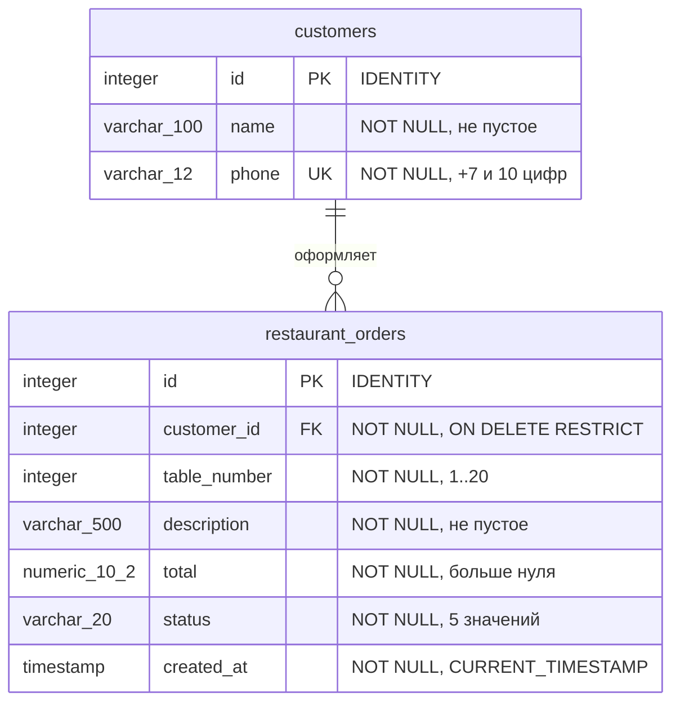

# ER-диаграмма ресторана

Графический файл: [ER.svg](ER.svg). Его можно открыть в браузере и распечатать.

Один клиент имеет **0..N заказов**. Каждый заказ принадлежит **ровно одному клиенту**. Связь: `restaurant_orders.customer_id → customers.id`. Все поля обеих таблиц обязательны; ID и время создания назначаются автоматически. Телефон уникален.
